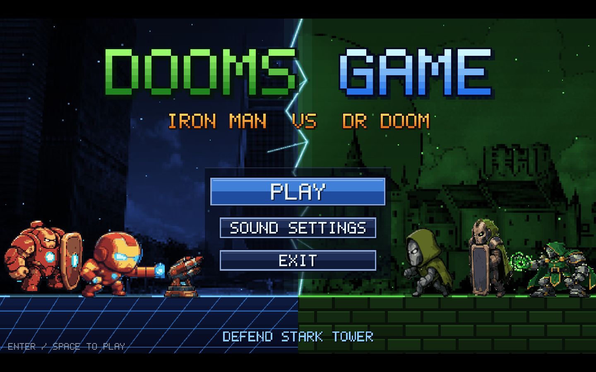
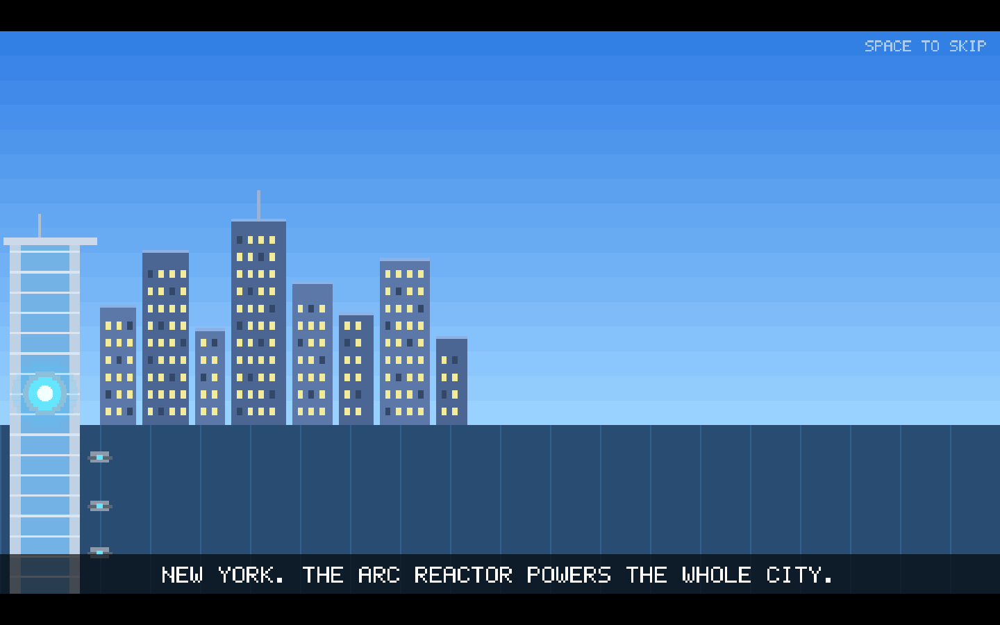
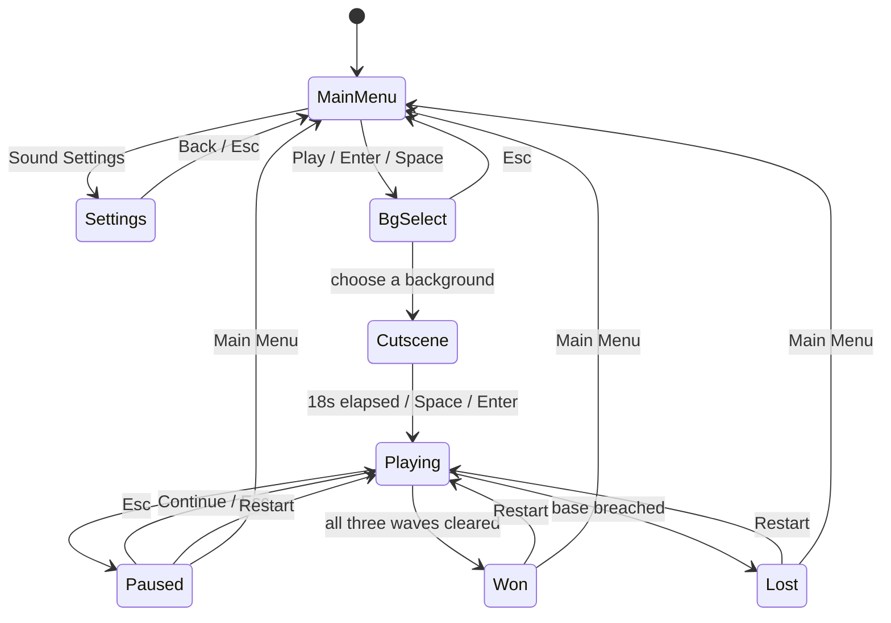
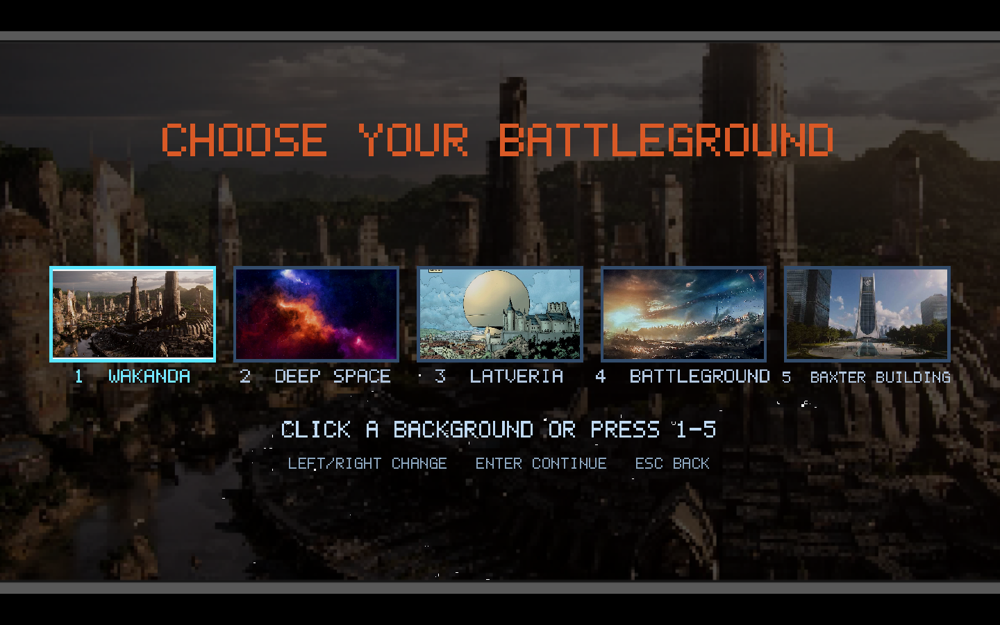
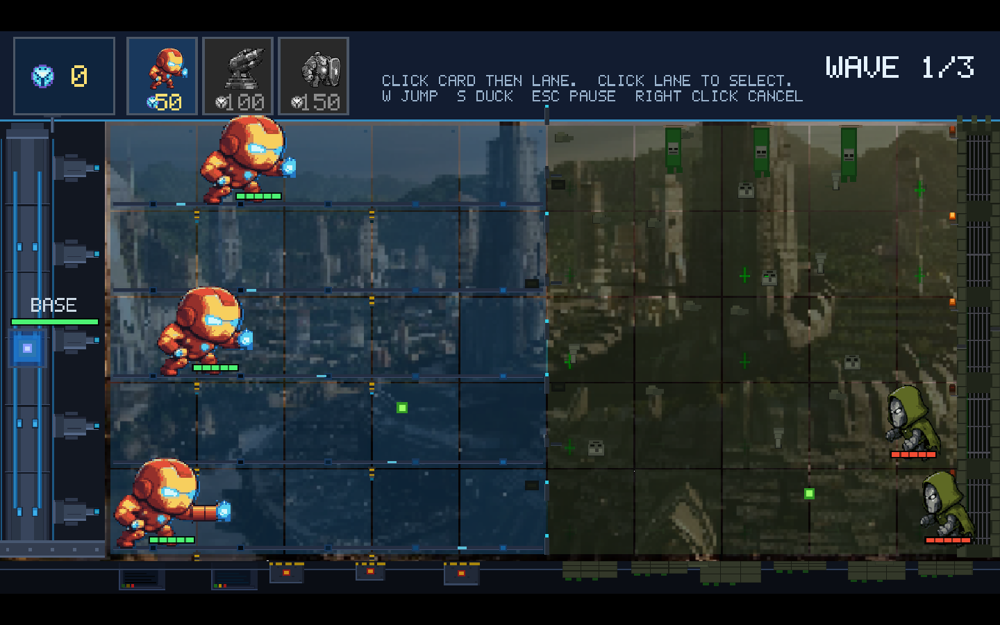
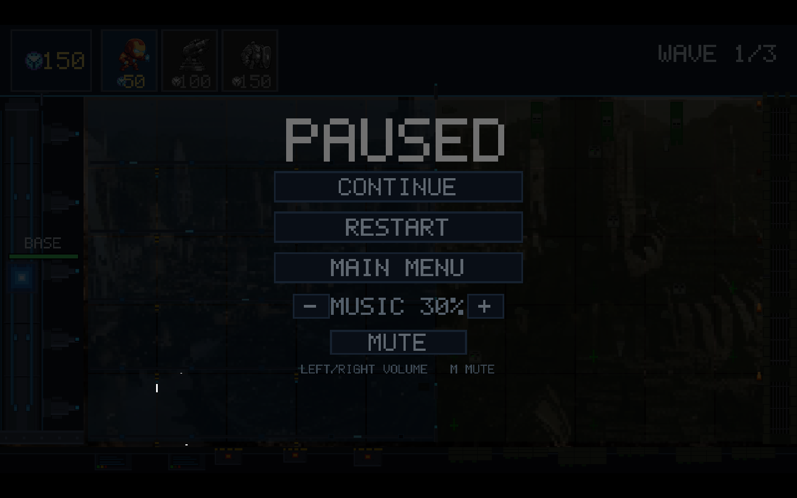
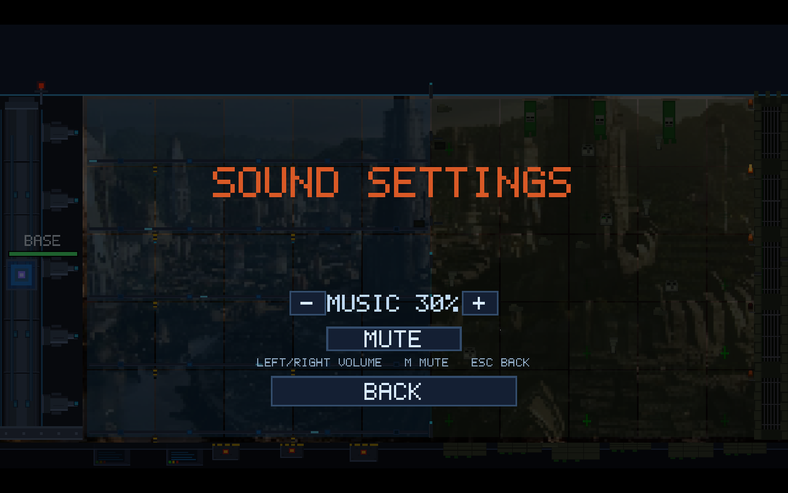

# DoomsGame: Iron Man vs Doctor Doom Tower Defense

> A five-lane, three-wave tower defense game in C++17 and OpenGL 3.3, built for DMET502 Lab 2.



## About

DMET502 Lab 2 starts from a bare OpenGL template. This project turns that template into a complete game: Iron Man defends Stark Tower against Doctor Doom's Doombots across five lanes, spending coins earned on the field on melee, ranged, and defense heroes. The presentation is built in-repo too — ASCII-authored sprites, a 5×7 bitmap font, five full-screen backgrounds, an animated intro, and a small audio layer — with no game engine or external asset pipeline.

## Features

- **Five-lane battlefield, three hero classes.** Melee (50), Ranged (100), and Defense (150) are defined in one tuning table in `Characters.cpp`. Ranged and Defense unlock at 160 and 240 held coins; locked cards render grayscale in the card bar (`UI.cpp`).
- **Three escalating waves.** 3, 5, and 10 Doombots per wave, with a fixed Easy → Easy/Medium → mixed-type progression. At most 10 enemies are alive at once, spawning every 2 seconds (`WaveSystem.cpp`).
- **Coin economy with a risk/reward loop.** Each defeated enemy drops 50 coins that a hero collects by walking over it (`Game.cpp:372`). Escorting a hero to the end of a lane pays back twice its cost (`Game.cpp:332`).
- **Combat with swept-segment projectiles.** Melee units hold the line; ranged units fire rockets whose movement is tested as a swept segment each frame, so fast projectiles cannot tunnel through enemies. Hits spawn explosion effects, health bars, and a red damage flash (`Game.cpp:443`).
- **Lane control.** Click a lane to select it, then make its heroes jump (`W` / `↑`) or duck (`S` / `↓`). Defense units are stationary by design (`Game.cpp:709`).
- **A full screen flow.** Main menu, sound settings, background chooser, an 18-second intro cutscene, pause, victory, and defeat, driven by one state enum (`Game.h:55`).
- **Five switchable backgrounds.** Wakanda, Deep Space, Latveria, Battleground, and Baxter Building are drawn cover-fit behind the board and selected from a thumbnail picker; `F2` cycles them at runtime (`Background.cpp`, `main.cpp:52`).
- **One batch for all pixel art.** Every sprite and glyph is authored as an ASCII grid, converted to triangles once at startup, and drawn from a single vertex buffer with one shader program (`Renderer.cpp`, `HeroSprites.h`).
- **Audio without a middleware dependency.** miniaudio 0.11.25 drives a looping theme, fire-and-forget sound effects, and voice lines, with volume and mute controls (`Audio.cpp`).



## Tech stack


- **Language:** C++17 (`stdcpp17` in `Template.vcxproj`)
- **Rendering:** OpenGL 3.3 Core via GLAD, GLFW 3.5.1, GLM
- **Assets:** PNG backgrounds loaded with stb_image; MP3 music, effects, and voice through miniaudio
- **Build:** Visual Studio solution `Template.sln` (Win32 and x64; the x64 configurations use the v142 toolset)

## Architecture

```text
Template/
├─ main.cpp                  window creation, input mapping, frame loop
├─ Game.cpp / .h             state machine, placement, combat, economy, HUD
├─ WaveSystem.cpp / .h       wave schedule and enemy spawning
├─ UI.cpp / .h               battlefield, card bar, menus, environment detail
├─ Renderer.cpp / .h         batched quads, pixel font, letterboxed viewport
├─ Background.cpp / .h       cover-fit background images and thumbnail picker
├─ Cutscene.cpp / .h         scripted 18-second intro sequence
├─ Audio.cpp / .h            miniaudio wrapper for music, SFX, and voice
├─ Characters.cpp / .h       unit tuning table (cost, HP, speed, damage)
├─ HeroSprites.h             ASCII art and palettes for heroes
├─ EnemySprites.h            ASCII art and palettes for enemies
├─ Config.h                  shared constants (lanes, economy, physics)
├─ assets/                   bg1–bg5.png, theme and effect MP3s
├─ External/include/         GLFW 3.5.1 headers
├─ include/                  GLAD headers
├─ lib/                      glfw3.lib
├─ glm/                      GLM headers
├─ src/                      vendored GLAD source
└─ docs/screenshots/         screenshots used by this README
```

The game is a single state machine. Input, update, and render all branch on the current `GameState`; gameplay simulation only runs in `Playing`.



## Getting started

### Prerequisites

- Windows 10 or 11
- Visual Studio 2019 or 2022 with the **Desktop development with C++** workload; the x64 configurations use the v142 toolset
- `MSBuild` on the `PATH` if you prefer the command line (available from the Visual Studio Developer Command Prompt)

No package installation or environment variables are required; all third-party libraries and assets are vendored in the repository.

### Build

Open `Template.sln`, select **Release** and **x64**, and build. From a Developer Command Prompt in the repository root:

```bat
msbuild Template.sln /p:Configuration=Release /p:Platform=x64
```

For a debug build, use `Configuration=Debug`. The executable is written to `x64\Release\Template.exe` or `x64\Debug\Template.exe`.

### Run

The game loads everything from relative paths, so launch it with the repository root as the working directory:

```bat
.\x64\Release\Template.exe
```

### Controls

| Action | Input |
| --- | --- |
| Place a hero | Click a card, then click a lane |
| Select or deselect a lane | Click a lane with no card armed |
| Jump / duck on selected lanes | `W` / `↑` and `S` / `↓` |
| Cancel an armed card | Right-click |
| Pause / resume | `Esc` |
| Restart after pause, victory, or defeat | `R` |
| Skip the intro cutscene | `Space` / `Enter` |
| Pick a background | Click a thumbnail, press `1`–`5`, or use `←` / `→` then `Enter` |
| Next background during play | `F2` |
| Music volume / mute | `←` / `→` and `M` on the settings or pause screen |

### Tests

No automated test target is configured in `Template.sln`; the game has been verified by manual playtesting.

## Screenshots

All screenshots were captured from the running build at 1440×900.

| Main menu | Background chooser |
| --- | --- |
|  |  |

| Gameplay: three lanes defended, wave 1 incoming | Pause menu |
| --- | --- |
|  |  |

| Intro cutscene | Sound settings |
| --- | --- |
|  |  |

## Challenges and what I learned

- **Sprite width was scaled twice, so hitboxes were a few pixels wide.** `Renderer::drawSprite` scales pixel-unit vertices by `f.w * scaleX`, which means the on-screen width is `f.w × f.w × scaleX`, not `f.w × scaleX`. Melee units walked into each other and fought back-to-back. `unitHalfWidth` now compensates for the double scaling (`Characters.cpp:34-39`); the reasoning is documented in the code because the correct formula is not obvious.
- **The wave clock must not run during the cutscene.** `reset()` initialises the wave timer from `glfwGetTime()`, so it is called when the cutscene ends rather than when Play is clicked (`Game.cpp:237-245`). Otherwise wave 1 would already be in progress when gameplay fades in.
- **Letterboxing keeps the simulation resolution-independent.** The world is always 1280×720 logic units; `Renderer::beginFrame` clears the whole window, then sets a centred 16:9 viewport and an orthographic projection in world units (`Renderer.cpp:233`). Every drawing call can therefore use fixed world coordinates.
- **Data-driven tuning paid off.** Unit stats live in a single table (`Characters.cpp`), so balance changes never touch gameplay code.

## Known limitations

- The layout is a fixed 16:9 playfield letterboxed into the window; there is no responsive or mobile UI.
- The base has a single hit point (`BASE_MAX_HP` in `Config.h`), so one breach ends the run.
- `WaveSystem.cpp` includes a standalone `WAVE_STANDALONE` test harness that is not part of the Visual Studio build.
- There is no persistence: coins, waves, and settings reset when the process exits.

## Author

**George Sameh** — GitHub: [@THEbeatles1970](https://github.com/THEbeatles1970)

Built for DMET502 Lab 2.
